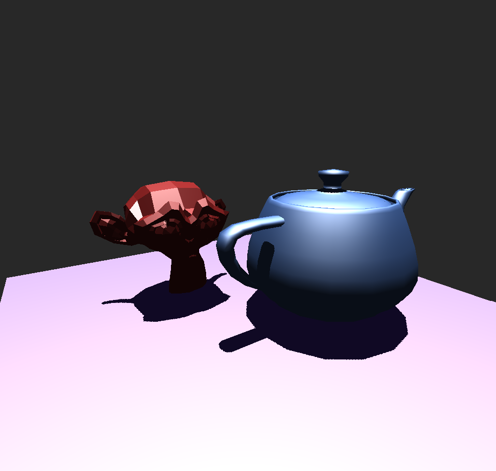

# Ferenc Renderer
<table>
  <tr>
    <td></td>
    <td></td>
  </tr>
  <tr>
    <td></td>
    <td></td>
  </tr>
</table>

Provides software rendering functions such as:

- Rendering various primitive shapes (squares, circles, polygons)
- Rendering triangles
	- 2D barycentric
	- 3D with vertex colors
	- 3D with UVs and texture
	- 3D with fragment shaders
- Near-plane clipping
- Shading with Blinn-Phong model
- Camera
- Shadow mapping
- Rendering .pbm textures
- Basic postprocessing

The 3D triangle rasterizer also interpolates vertex data in perspective-correct way.

The demo `application/main.c` provides a basic rendering pipeline and a few objects loaded from .obj files
These are rendered with blinn-phong shader and shadow map.

## Ferenc Math

Provides mostly linear algebra functions but also some ready-made functions for transformations

## Ferenc Audio

Provides functions for reading and playing MIDI files using sinusoidal software synthesis.

## Ferenc Engine

Provides a lightweight "game engine" and allows for the creation of entities with draw/update/audio callbacks.

## Comment on dependencies

Each module is platform-agnostic, i.e., it is oblivious to what windowing or audio backend is used. The example `main.c` file uses SDL2, but it can easily be adapted to other libraries. Further, each module only depends on the C standard library and uses only C99 features.

## Building

```sh
git clone https://github.com/noponn8000/ferenc_renderer
cd ferenc_renderer
./run.sh # or `make` and then `build/program`
```

Dependencies:
- SDL2
- libc
