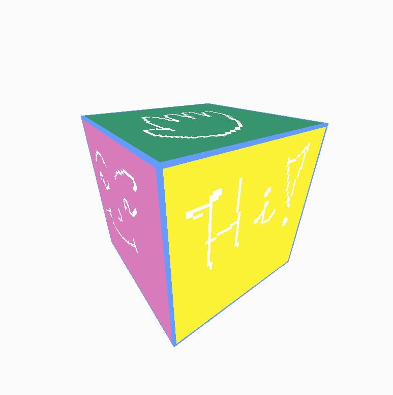
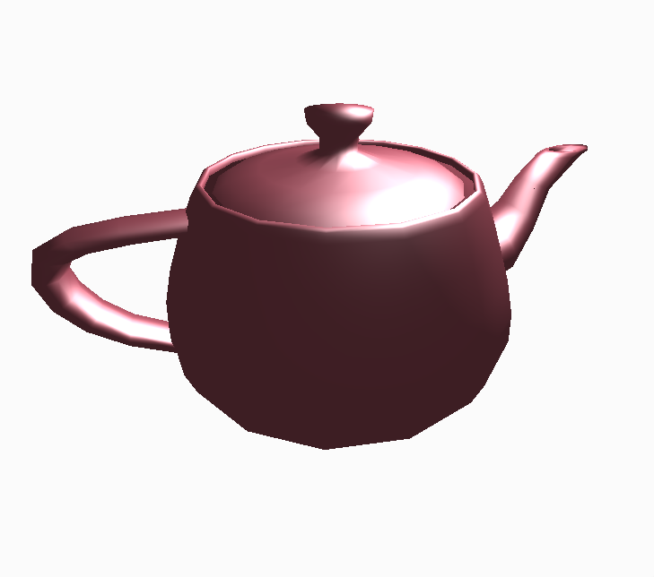
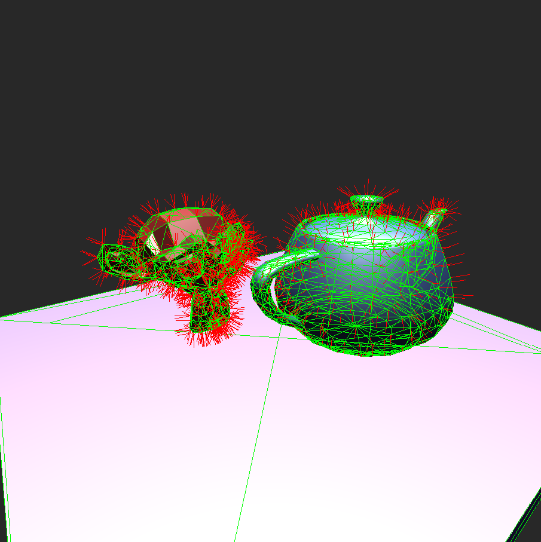

# Ferenc Renderer
<table>
  <tr>
    <td></td>
    <td></td>
  </tr>
  <tr>
    <td></td>
    <td></td>
  </tr>
</table>

Provides software rendering functions such as:

- Rendering various shapes (squares, circles, polygons)
- Rendering triangles
	- 2D barycentric
	- 3D with vertex colors
	- 3D with UVs and texture
- Rendering .pbm textures
- Basic postprocessing 

## Ferenc Audio

Provides functions for reading and playing MIDI files using sinusoidal software synthesis.

## Ferenc Engine

Provides a lightweight "game engine" and allows for the creation of entities with draw/update/audio callbacks.

## Comment on dependencies

Each module is platform-agnostic, i.e., it is oblivious to what windowing or audio backend is used. The example `main.c` file uses SDL2, but it can easily be adapted to other libraries. Further, each module only depends on the C standard library and uses only C99 features.
